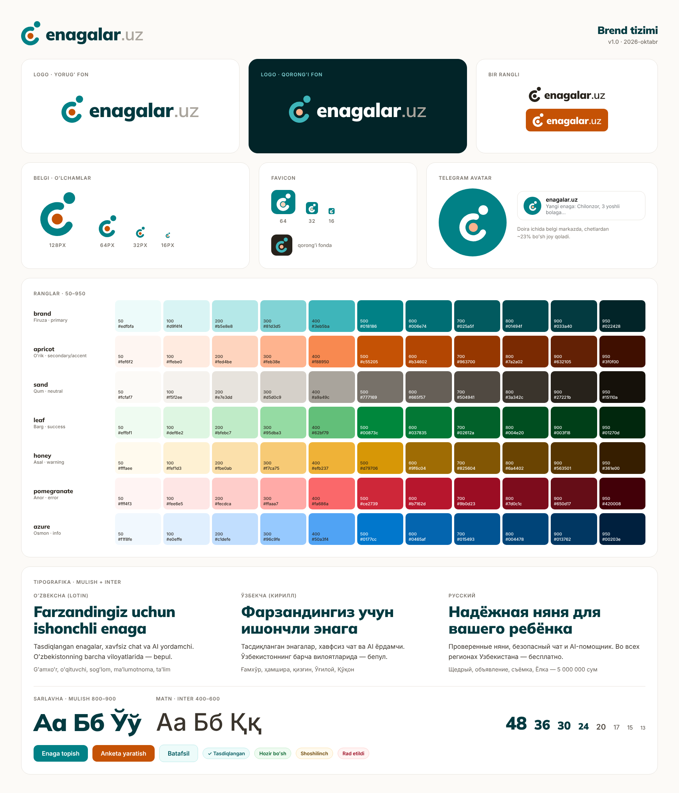

# enagalar.uz — brend kitobi

> Versiya 1.0 · 2026-yil 22-oktabr. Brend doskasi: [brand-board.png](brand-board.png).
> Fayllar: `frontend/public/brand/`, ranglar: `frontend/app/assets/css/brand.css`.



## 1. Pozitsiya

**Kim uchun:** farzandiga ishonchli enaga qidirayotgan ota-onalar (ko'pincha onalar, telefondan, Telegramda yashaydi) va ish qidirayotgan enagalar (25–55 yosh, raqamli ko'nikmasi oddiy).

**Pozitsiya jumlasi:**
> enagalar.uz — O'zbekistondagi ota-onalar uchun **tekshirilgan** enagani topish va u bilan **xavfsiz** gaplashishning eng sodda yo'li. Telegram kanallardagi tartibsizlik o'rniga — nishonli anketalar, ichki chat va AI yordamchi. Boshida bepul, barcha viloyatlarda.

**Raqobatchilardan farqimiz (brend tilida):**

| Ular | Biz |
|---|---|
| Telegram kanallar: tekshiruvsiz e'lon, eski post, firibgarlik | "Tasdiqlangan" nishoni, 30 kunlik e'lon, shikoyat va moderatsiya |
| bolambilan.uz: kontakt pullik obuna bilan ochiladi, chat yo'q | Boshida bepul, Telegramga o'xshash ichki chat |
| homecare.uz: umumiy e'lon doskasi | Faqat bolalar parvarishi, ota-ona va enaga teng huquqli |
| Faqat Toshkent | Butun O'zbekiston |

**Brend va'dasi (bitta so'z bilan):** *Xotirjamlik.* Ota-ona ishga xotirjam ketadi, enaga ishini xotirjam qiladi.

## 2. Qadriyatlar

1. **Ishonch** — har bir va'da tekshiriladi. Nishon — bu haqiqiy tekshiruv, bezak emas.
2. **G'amxo'rlik** — bola birinchi o'rinda. Ota-ona ham, enaga ham hurmatga loyiq.
3. **Soddalik** — buvijon ham tushunadigan interfeys va matn. Murakkab so'z yo'q.
4. **Ochiqlik** — yashirin to'lov, mayda harf yo'q. "Bepul" degan bo'lsak — bepul.
5. **Yaqinlik** — Toshkentdan Nukusgacha, o'zbekcha va ruscha, o'z tilida.

## 3. Shaxsiyat

Agar enagalar.uz inson bo'lganida: **tajribali, mehribon va tartibli qo'shni opa** — maslahat beradi, lekin aqlli bo'lib ko'rinmaydi; xavf haqida ogohlantiradi, lekin qo'rqitmaydi.

| U shunday | Lekin bunday emas |
|---|---|
| Iliq, samimiy | Shirin-shakar, sentimental |
| Ishonchli, aniq | Rasmiy, byurokratik |
| Zamonaviy | Sovuq "texno", startap jargoni |
| Mahalliy | Milliy kitsch (do'ppi, choynak, naqsh to'ri) |
| Xotirjam | Vahimali ("Bolangiz xavf ostida!") |

## 4. Ovoz va ohang (tone of voice)

**Asosiy qoidalar:**
- Foydalanuvchiga **"siz"** deb murojaat qilamiz (ruschada **"вы"**, kichik harf bilan). Enagaga ham, ota-onaga ham bir xil hurmat.
- Qisqa gap. Bir gapda bitta fikr. Tugma matni — fe'l bilan boshlanadi ("Enaga topish", "Xabar yozish").
- Raqam va fakt bilan gapiramiz: "Pasporti tekshirilgan", "1 soat ichida javob beradi" — "eng zo'r enagalar" emas.
- Xato — foydalanuvchining aybi emas. "Siz noto'g'ri kiritdingiz" emas, "Raqamni tekshirib ko'ring".
- Xavfsizlik haqida — xotirjam, amaliy maslahat: "Oldindan pul o'tkazmang" (qo'rqitmasdan).
- Atamalar bir xil: **enaga** (не "няня-сиделка"), **ota-ona**, **e'lon** (vakansiya), **anketa** (enaga profili), **nishon**, **tasdiqlangan**, **chat**.
- **Imlo:** sarlavha va marketing matnlarida to'g'ri belgilar: **oʻ, gʻ** (U+02BB) va **ʼ** tutuq belgisi (U+02BC). Mulish va Inter ikkalasi ham bu belgilarni to'liq qo'llaydi. Interfeys matnlarida (i18n) oddiy `'` ham qabul qilinadi, lekin bitta sahifada aralashtirmang.

### 4.1 Hero sarlavha variantlari

| # | O'zbekcha | Русский |
|---|---|---|
| 1 ⭐ | **Farzandingiz uchun ishonchli enaga** | **Надёжная няня для вашего ребёнка** |
| 2 | Tekshirilgan enagalar. Xotirjam ota-onalar. | Проверенные няни. Спокойные родители. |
| 3 | Ishonchli enaga — uyingizga yaqin | Надёжная няня — рядом с домом |
| 4 | Enaga topish endi Telegram kanal titkilash emas | Найти няню — больше не листать Telegram-каналы |

**Hero tagmatni:** "Tasdiqlangan enagalar, xavfsiz chat va AI yordamchi — butun Oʻzbekiston boʻylab. Bepul." / «Проверенные няни, безопасный чат и AI-помощник — по всему Узбекистану. Бесплатно.»

**Enagalar uchun sarlavha:** "Ishingizni qadrlaydigan oilalarni toping" / «Найдите семью, которая ценит ваш труд».

### 4.2 Tugma (CTA) matnlari

| Joy | O'zbekcha | Русский |
|---|---|---|
| Asosiy (ota-ona) | Enaga topish | Найти няню |
| Asosiy (enaga) | Anketa yaratish | Создать анкету |
| E'lon berish | E'lon joylash | Разместить объявление |
| Javob | Javob berish | Откликнуться |
| Chat | Xabar yozish | Написать |
| Tekshiruv | Tasdiqlanish | Пройти проверку |
| Ro'yxat | Bepul boshlash | Начать бесплатно |
| Telegram | Telegram orqali kirish | Войти через Telegram |
| AI | AI bilan yozish | Написать с AI |

### 4.3 Bo'sh holat (empty state)

| Joy | O'zbekcha | Русский |
|---|---|---|
| Qidiruv natijasi yo'q | Hozircha mos enaga topilmadi. Filtrni biroz kengaytirib ko'ring yoki e'lon joylang — enagalar o'zi yozadi. | Пока не нашли подходящую няню. Попробуйте расширить фильтр или разместите объявление — няни напишут сами. |
| Chatlar bo'sh | Bu yerda suhbatlaringiz bo'ladi. Yoqqan anketaga "Xabar yozish" tugmasini bosing. | Здесь появятся ваши переписки. Нажмите «Написать» в понравившейся анкете. |
| Sevimlilar bo'sh | Yoqqan anketalarni ♡ bilan saqlang — keyin shu yerdan topasiz. | Сохраняйте понравившиеся анкеты ♡ — они будут здесь. |
| Enagaga javob yo'q | Hali javoblar yo'q. Odatda birinchi javob 1 kun ichida keladi. | Откликов пока нет. Обычно первый приходит в течение дня. |

### 4.4 Xato xabarlari

| Holat | O'zbekcha | Русский |
|---|---|---|
| Umumiy | Nimadir xato ketdi. Bir daqiqadan keyin qayta urinib ko'ring. | Что-то пошло не так. Попробуйте ещё раз через минуту. |
| Internet | Internet bilan aloqa yo'q. Ulanib, qayta urinib ko'ring. | Нет связи с интернетом. Проверьте подключение. |
| Telefon raqam | Raqamni tekshirib ko'ring: +998 XX XXX XX XX | Проверьте номер: +998 XX XXX XX XX |
| SMS kod | Kod mos kelmadi. Yangisini so'rash mumkin. | Код не подошёл. Можно запросить новый. |
| 404 | Bu sahifa topilmadi. Balki e'lon muddati tugagandir. | Страница не найдена. Возможно, объявление уже снято. |
| Chatda kontakt | Ehtiyot bo'ling: tanishuvdan oldin pul o'tkazmang va pasport rasmini yubormang. | Будьте осторожны: не переводите деньги и не отправляйте фото паспорта до встречи. |

### 4.5 Muvaffaqiyat va nishonlar

- "Anketangiz tekshiruvga yuborildi. Odatda 24 soat ichida javob beramiz." / «Анкета отправлена на проверку. Обычно отвечаем в течение 24 часов.»
- Nishon nomlari qisqa: **Tasdiqlangan · Tibbiy ma'lumotnoma · Tavsiya qilingan · Tez javob beradi** / **Проверена · Медсправка · Рекомендуем · Быстро отвечает**.

## 5. Nom bo'yicha eslatmalar

- Yozilishi: **enagalar.uz** — doim kichik harf bilan, bitta so'z. Gap boshida ham: "enagalar.uz — …". "Enagalar.UZ", "ENAGALAR", "Enaga lar" — **noto'g'ri**.
- Ruscha matnda ham lotincha qoladi: «на enagalar.uz». Kirillga o'girmang (энагалар.уз — yo'q).
- Logoda ".uz" xira (sand-400) beriladi: asosiy so'z — *enagalar*. Juda kichik joyda (avatar, favicon) faqat belgi ishlatiladi.
- Telegram: bot va kanallar (UZ va RU alohida) nomida "enagalar_uz" ko'rinishi tavsiya etiladi (bo'sh username'ni tekshirish kerak). Diqqat: **@enagalar** nomli Telegram kanal boshqa egaga tegishli (34,9 ming obunachi) — chalkashlik bo'lmasligi uchun avatar va kanal nomida doim logomizdagi belgi va ".uz" bo'lsin.
- So'z ma'nosi: *enaga* — bolaga qaraydigan ayol; *-lar* — ko'plik. Ya'ni "enagalar" — ko'plab tanlov bitta joyda.

## 6. Logo

### 6.1 Uchta konsepsiya

| # | Fayl | G'oya | Baho |
|---|---|---|---|
| 1 ✅ | [concept-1.svg](logo-concepts/concept-1.svg) | **"Quchoq"** — kattalar (bosh + quchoqlayotgan qo'l yoyi) bolani (o'rtadagi o'rik rangli nuqta) bag'riga olgan. Yoy ochiq tomoni o'ngga — oldinga, o'qish yo'nalishiga qaragan. | Eng sodda, bitta rangda ishlaydi, doira ichiga ideal tushadi, 16 px da ham o'qiladi. Raqobatchilarnikiga o'xshamaydi. |
| 2 | [concept-2.svg](logo-concepts/concept-2.svg) | **"Ravoq"** — Registon peshtoqi shaklidagi uy/eshik, ichida yurak (bo'sh joy bilan). Uy, boshpana, mahalliylik. | Mahalliy, lekin "uy-joy / ko'chmas mulk" brendiga o'xshab qoladi; bola va inson yo'q. Telegram doirasida tepa uchi qisiladi. |
| 3 | [concept-3.svg](logo-concepts/concept-3.svg) | **"Yurak-quchoq"** — kattaning qo'llari yurak shaklini hosil qilib, ichida bolani ushlab turibdi. | Hissiy, lekin "yurak + nuqta" tibbiyot va xayriya logolarida juda ko'p; kichik o'lchamda chiziqlar qo'shilib ketadi. |

### 6.2 Tanlangan belgi: "Quchoq"

- **Ma'nosi:** g'amxo'rlik (quchoq), xavfsizlik (bolani o'rab turgan himoya halqasi), kattalar va bola (katta va kichik doira), ochiqlik (halqa yopiq emas — ota-ona va enaga bilan aloqa). Bola nuqtasi iliq o'rik rangida — butun tizimdagi yagona "issiq" nuqta.
- **Geometriya:** 64×64 to'r; yoy radiusi 17, qalinligi 9,5, uchlari yumaloq; bosh r=7,5; bola r=7. Favicon uchun qalinroq versiya (qalinlik 11, bosh 8,2). Yumaloq uchlar Mulish harflarining yumshoq shakliga mos.
- **Wordmark:** "enagalar" — **Mulish Black (900)**, harflararo −20/1000, konturga (path) aylantirilgan. Mulishdagi bir qavatli "a" (ɑ) uch marta takrorlanib, belgidagi doiralar ritmini davom ettiradi. ".uz" — Mulish SemiBold (600), sand-400, xira.
- **Joylashuv:** wordmark x-balandligining o'rtasi bolaning nuqtasi markazi bilan bir chiziqda; belgi va so'z orasidagi masofa = belgi balandligining ~22%.

### 6.3 Fayllar

| Fayl | Qayerda ishlatiladi |
|---|---|
| `frontend/public/brand/logo.svg` | Asosiy gorizontal logo, yorug' fon |
| `frontend/public/brand/logo-dark.svg` | Qorong'i fon (brand-950, sand-900) |
| `frontend/public/brand/logo-mono.svg` | Bir rangli, `currentColor` — CSS `color` bilan bo'yaladi |
| `frontend/public/brand/mark.svg` | Faqat belgi, yorug' fon |
| `frontend/public/brand/mark-dark.svg` | Faqat belgi, qorong'i fon |
| `frontend/public/brand/mark-mono.svg` | Bir rangli belgi, `currentColor` |
| `frontend/public/brand/favicon.svg` | Favicon (firuza plitka, oq belgi) |
| `frontend/public/favicon.ico` | 16/32/48 px ICO |
| `frontend/public/brand/apple-touch-icon.png` | 180×180, iOS |
| `frontend/public/brand/og-image.png` | 1200×630, ijtimoiy tarmoq / Telegram havola ko'rinishi |
| `docs/brand/telegram-avatar.png` | 640×640, Telegram bot va kanal avatari |
| `docs/brand/brand-board.png` | Brend doskasi |

### 6.4 Qoidalar

- **Bo'sh joy:** logo atrofida kamida bosh doirasi diametri (≈ belgi balandligining 24%) bo'sh qoladi.
- **Minimal o'lcham:** gorizontal logo — 24 px balandlik (ekranda), 8 mm (bosmada). Undan kichik — faqat belgi.
- **Belgi:** 24 px dan kichikda `favicon.svg` (qalin versiya) ishlatiladi.
- **Mumkin emas:** cho'zish, qiyshaytirish, soya/gradient qo'shish, ranglarini almashtirish (bola nuqtasi doim o'rik yoki bir rangli), wordmarkni boshqa shriftda yozish, belgini aylantirish, rasm ustiga kontrastsiz qo'yish.

## 7. Ranglar

**G'oya — Rishton sopol buyumlari palitrasi:** firuza sir (ishonch, xotirjamlik, osmon va Samarqand gumbazlari) + o'rik/terrakota (iliqlik, onalik, uy). Mahalliy ildiz bor, lekin naqsh va kitsch yo'q. Neytral rang sovuq "slate" emas — iliq qum kulrangi.

Barcha shkalalar OKLCH'da teng yorug'lik qadamlari bilan qurilgan. **500-qadam — "brend rangi"**: unga oq matn qo'yilsa WCAG AA (≥4,5:1) o'tadi (warning bundan mustasno). Shuning uchun Nuxt UI'ning standart `solid` tugmasi (`bg-primary` + oq matn) qo'shimcha sozlashsiz AA'dan o'tadi.

| Nom | Rol | 500 | 600 | 700 |
|---|---|---|---|---|
| **brand** (Firuza) | primary | `#018186` | `#006e74` | `#025a5f` |
| **apricot** (Oʻrik) | secondary / accent | `#c55205` | `#b34602` | `#963700` |
| **sand** (Qum) | neutral | `#777169` | `#665f57` | `#504941` |
| **leaf** (Barg) | success | `#00873c` | `#037835` | `#02612a` |
| **honey** (Asal) | warning | `#d79706` | `#9f6c04` | `#825604` |
| **pomegranate** (Anor) | error | `#ce2739` | `#b7162d` | `#9b0d23` |
| **azure** (Osmon) | info | `#0177cc` | `#0465af` | `#015493` |

### 7.1 To'liq shkalalar (50–950)

| Shkala | 50 | 100 | 200 | 300 | 400 | 500 | 600 | 700 | 800 | 900 | 950 |
|---|---|---|---|---|---|---|---|---|---|---|---|
| `brand` | `#edfbfa` | `#d9f4f4` | `#b5e8e8` | `#81d3d5` | `#3eb5ba` | `#018186` | `#006e74` | `#025a5f` | `#01494f` | `#033a40` | `#022428` |
| `apricot` | `#fef6f2` | `#ffebe0` | `#fed4be` | `#feb38e` | `#f88950` | `#c55205` | `#b34602` | `#963700` | `#7a2a02` | `#632105` | `#3f0f00` |
| `sand` | `#fcfaf7` | `#f5f2ee` | `#e7e3dd` | `#d5d0c9` | `#a9a49c` | `#777169` | `#665f57` | `#504941` | `#3a342c` | `#27221b` | `#15110a` |
| `leaf` | `#effbf1` | `#def6e2` | `#bfebc7` | `#95dba3` | `#62bf79` | `#00873c` | `#037835` | `#02612a` | `#004e20` | `#003f18` | `#01270d` |
| `honey` | `#fffaee` | `#fef1d3` | `#fbe0ab` | `#f7ca75` | `#efb237` | `#d79706` | `#9f6c04` | `#825604` | `#6a4402` | `#563501` | `#361e00` |
| `pomegranate` | `#fff4f3` | `#fee6e5` | `#fecdca` | `#ffaaa7` | `#fa686a` | `#ce2739` | `#b7162d` | `#9b0d23` | `#7d0c1c` | `#650d17` | `#420008` |
| `azure` | `#f1f8fe` | `#e0effe` | `#c1defe` | `#96c9fe` | `#50a3f4` | `#0177cc` | `#0465af` | `#015493` | `#004478` | `#013762` | `#00203e` |

### 7.2 Kontrast tekshiruvi (WCAG 2.1)

AA: oddiy matn ≥ 4,5:1, katta matn va UI elementlari ≥ 3:1. AAA: ≥ 7:1.

| Rejim | Juftlik | Ranglar | Nisbat | Natija |
|---|---|---|---|---|
| Light | Asosiy matn sand-700 / oq | `#504941` / `#ffffff` | **8.86:1** | AAA |
| Light | Sarlavha sand-900 / oq | `#27221b` / `#ffffff` | **15.78:1** | AAA |
| Light | Muted sand-500 / oq | `#777169` / `#ffffff` | **4.83:1** | AA |
| Light | Muted sand-500 / sand-50 fon | `#777169` / `#fcfaf7` | **4.63:1** | AA |
| Light | Dimmed sand-400 / oq (faqat dekor, placeholder emas) | `#a9a49c` / `#ffffff` | **2.48:1** | Matn uchun emas |
| Light | Oq matn / brand-500 tugma | `#ffffff` / `#018186` | **4.68:1** | AA |
| Light | Oq matn / brand-600 hover | `#ffffff` / `#006e74` | **6.03:1** | AA |
| Light | Havola brand-600 / oq | `#006e74` / `#ffffff` | **6.03:1** | AA |
| Light | brand-700 / brand-50 (soft nishon) | `#025a5f` / `#edfbfa` | **7.52:1** | AAA |
| Light | Oq matn / apricot-500 tugma | `#ffffff` / `#c55205` | **4.58:1** | AA |
| Light | apricot-700 / apricot-50 | `#963700` / `#fef6f2` | **6.92:1** | AA |
| Light | Oq matn / leaf-500 | `#ffffff` / `#00873c` | **4.63:1** | AA |
| Light | Oq matn / pomegranate-500 | `#ffffff` / `#ce2739` | **5.28:1** | AA |
| Light | Oq matn / azure-500 | `#ffffff` / `#0177cc` | **4.65:1** | AA |
| Light | Oq matn / honey-500 (TAQIQ) | `#ffffff` / `#d79706` | **2.52:1** | Matn uchun emas |
| Light | Oq matn / honey-600 | `#ffffff` / `#9f6c04` | **4.54:1** | AA |
| Light | honey-900 / honey-400 | `#563501` / `#efb237` | **5.82:1** | AA |
| Light | honey-800 / honey-50 | `#6a4402` / `#fffaee` | **8.26:1** | AAA |
| Dark | Matn sand-200 / sand-900 fon | `#e7e3dd` / `#27221b` | **12.34:1** | AAA |
| Dark | Muted sand-400 / sand-900 | `#a9a49c` / `#27221b` | **6.37:1** | AA |
| Dark | sand-900 matn / brand-400 tugma | `#27221b` / `#3eb5ba` | **6.40:1** | AA |
| Dark | Havola brand-300 / sand-900 | `#81d3d5` / `#27221b` | **9.18:1** | AAA |
| Dark | sand-900 matn / apricot-400 | `#27221b` / `#f88950` | **6.53:1** | AA |
| Dark | sand-900 / leaf-400 | `#27221b` / `#62bf79` | **6.95:1** | AA |
| Dark | sand-900 / pomegranate-400 | `#27221b` / `#fa686a` | **5.45:1** | AA |
| Dark | sand-900 / honey-400 | `#27221b` / `#efb237` | **8.34:1** | AAA |
| Dark | sand-900 / azure-400 | `#27221b` / `#50a3f4` | **5.93:1** | AA |
| Logo | Wordmark brand-900 / oq | `#033a40` / `#ffffff` | **12.48:1** | AAA |
| Logo | Belgi brand-500 / oq | `#018186` / `#ffffff` | **4.68:1** | AA |
| Logo | Belgi brand-400 / brand-950 | `#3eb5ba` / `#022428` | **6.63:1** | AA |

### 7.3 Yorug' rejim (light)

- **Fon:** sahifa `sand-50` (`#fcfaf7`, iliq oq), kartochkalar `#ffffff`, ajratgich `sand-200`.
- **Matn:** sarlavha `sand-900`, asosiy matn `sand-700`, ikkinchi darajali `sand-500`. `sand-400` — faqat ikonka/dekor, matn uchun emas (2,48:1).
- **Asosiy tugma:** `brand-500` + oq matn, hover `brand-600`. Havolalar `brand-600`.
- **Accent (o'rik):** sahifada bitta eng muhim harakat yoki "issiq" urg'u uchun (masalan, enaga uchun "Anketa yaratish", "Shoshilinch"). Bir ekranda 1–2 martadan ko'p emas. Fon sifatida `apricot-50/100`.
- **Nishonlar:** soft uslub — `*-50` fon, `*-200` chegara, `*-700` matn (honey uchun `honey-800`).
- **Warning:** oq matnni `honey-500` ustiga qo'ymang (2,52:1). Solid warning — `honey-400` fon + `honey-900` matn, yoki `honey-600` + oq.

### 7.4 Qorong'i rejim (dark)

- **Fon:** sahifa `sand-950` yoki `sand-900`, kartochka `sand-900`/`sand-800`. Brend sahifalar (hero, footer) uchun `brand-950`.
- **Matn:** `sand-200` asosiy, `sand-400` ikkinchi darajali (6,37:1).
- **Asosiy tugma:** `brand-400` + `sand-900` matn (6,40:1) — Nuxt UI dark rejimda aynan shunday qiladi (`--ui-primary` = 400, `text-inverted` = neutral-900).
- **Havolalar:** `brand-300`. Semantik ranglar 400-qadamda, ustida qorong'i matn.
- Logo: `logo-dark.svg` (belgi `brand-400`, bola `apricot-300`, so'z oq).

## 8. Tipografika

| Rol | Shrift | Og'irlik | Nega |
|---|---|---|---|
| Sarlavha, raqamlar, logo | **Mulish** (Google Fonts) | 800 ExtraBold, 900 Black | Yumshoq, yumaloq geometrik, bir qavatli "ɑ" — iliq, lekin jiddiy. Logodagi wordmark ham Mulish. |
| Matn va interfeys | **Inter** (Google Fonts) | 400, 500, 600 | Kichik ekranda eng yaxshi o'qiladigan shriftlardan biri, kirill va lotinni bir xil sifatda chizadi, tabular raqamlar (narxlar: 5 000 000 so'm). |

**Til qo'llab-quvvatlash tekshirildi** (shrift fayllaridan): ikkala shriftda ham `oʻ gʻ` (U+02BB), `ʼ` (U+02BC), `‘`, va o'zbek kirilli `Ўў Ққ Ғғ Ҳҳ` bor. Tekshirilgan, lekin **mos kelmagan** shriftlar: Manrope, Rubik, Golos Text, Geologica, Jost, Plus Jakarta Sans, Unbounded, Comfortaa, Quicksand (U+02BB yoki Ққ/Ҳҳ yo'q).

Google Fonts'dan yuklashda subsetlar: `latin`, `latin-ext`, `cyrillic`, `cyrillic-ext` (ў, қ, ғ, ҳ aynan **cyrillic-ext** ichida!).

### 8.1 Tip shkalasi (mobil → desktop)

| Token | Mobil | Desktop | Shrift | Qator balandligi |
|---|---|---|---|---|
| Display (hero) | 36 px | 56 px | Mulish 900, −0,025em | 1,05 |
| H1 | 30 px | 40 px | Mulish 800, −0,02em | 1,15 |
| H2 | 24 px | 30 px | Mulish 800, −0,015em | 1,2 |
| H3 | 20 px | 24 px | Mulish 800 | 1,3 |
| Lead | 18 px | 20 px | Inter 400 | 1,6 |
| Body | 16 px | 16–17 px | Inter 400 | 1,6 |
| Small / UI | 14 px | 14 px | Inter 500 | 1,5 |
| Caption | 13 px | 13 px | Inter 500 | 1,4 |
| Overline | 12 px | 12 px | Inter 600, UPPERCASE, +0,08em | 1,4 |

- Body hech qachon 16 px dan kichik emas (enagalar va telefon: iOS'da 16 px dan kichik inputga zoom bo'ladi).
- Tugma: Inter 600, 16 px; radius 12 px (`rounded-xl`). Nishon (badge): to'liq yumaloq.
- O'zbekcha so'zlar uzun ("Tasdiqlanganlar", "ma'lumotnomalar") — sarlavhalarda `text-wrap: balance`, tugmalarda qisqa fe'l.

## 9. Shakl va uslub

- **Burchaklar yumaloq:** kartochka 20–24 px, tugma va input 12 px, nishon — to'liq yumaloq. O'tkir burchak yo'q.
- **Soyalar:** yumshoq va iliq (`0 1px 2px rgb(39 34 27 / .06), 0 8px 24px rgb(39 34 27 / .06)`), qora qattiq soya yo'q.
- **Ikonkalar:** Lucide (Nuxt UI standart), 1,75–2 px chiziq, yumaloq uchlar — logoga mos.
- **Fotosurat:** haqiqiy o'zbek oilalari va enagalar, tabiiy kunduzgi yorug'lik, iliq ranglar. Bolaning yuzi aniq ko'rinadigan rasmlarni ishlatmaslik yoki ruxsat olish. Stok "yevropa oilasi" — yo'q.
- **Illustratsiya:** belgidagi doira va yoylardan yasalgan oddiy shakllar (firuza + o'rik + qum).

## 10. Do / Don't

| ✅ Qiling | ❌ Qilmang |
|---|---|
| Ishonchni fakt bilan ko'rsating: "Pasporti tekshirilgan", "3 ta sharh" | "Eng yaxshi", "100% xavfsiz" kabi tekshirib bo'lmaydigan va'dalar |
| Firuzani asosiy, o'rikni kam va aniq joyda ishlating | Butun sahifani o'rik rangiga bo'yash, ko'p rangli "kamalak" |
| Ota-ona va enagaga bir xil hurmat bilan yozing | Enagaga "xizmatkor" ohangida yozish |
| O'zbekcha matnni birinchi yozing, ruschasini moslang | Ruschadan so'zma-so'z tarjima |
| Xavfsizlik maslahatini xotirjam ohangda bering | Qo'rqitish, jinoyat hikoyalari bilan reklama |
| Logoni o'z fayllaridan oling (`/brand/*.svg`) | Logoni matn bilan qayta yozish yoki skrinshot qilish |
| Milliy ildizni rang va iliqlikda bildiring | Do'ppi, atlas naqshi, choynak kabi kitsch elementlar |

## 11. UI uchun texnik eslatmalar

1. `main.css`: `@import "tailwindcss"; @import "@nuxt/ui"; @import "./brand.css";`
2. `app.config.ts`:
   ```ts
   ui: { colors: { primary: 'brand', secondary: 'apricot', neutral: 'sand',
                   success: 'leaf', warning: 'honey', error: 'pomegranate', info: 'azure' } }
   ```
   Alias nomlari standart (`primary`, `secondary`, …) — `nuxt.config.ts` → `ui.theme.colors` ni o'zgartirish shart emas, faqat alias qiymatlari yangi shkalalarga ishora qiladi.
3. Kontrastni to'liq AA qilish uchun tavsiya etilgan override (`brand.css` dan keyin, `:root` ichida):
   ```css
   :root { --ui-text-dimmed: var(--ui-color-neutral-500); --ui-warning: var(--ui-color-warning-600); }
   .dark { --ui-text-dimmed: var(--ui-color-neutral-400); }
   ```
   (Nuxt UI standartda `dimmed` = neutral-400 → oq fonda 2,48:1.)
4. Shriftlar `brand.css` ichida `--font-sans: 'Inter'` va `--font-display: 'Mulish'` sifatida berilgan. Nuxt UI tarkibidagi `@nuxt/fonts` ularni avtomatik yuklaydi; sarlavhalarga `font-display` klassi. Subset: `cyrillic-ext` majburiy.
5. Sahifa foni: light `bg-sand-50` yoki `--ui-bg: var(--ui-color-neutral-50)`; dark `--ui-bg: var(--ui-color-neutral-950)`.
6. `nuxt.config.ts` → `app.head.link`: `favicon.svg` (`type="image/svg+xml"`), `favicon.ico`, `apple-touch-icon.png`; `meta`: `theme-color` = `#018186`, `og:image` = `/brand/og-image.png`.
